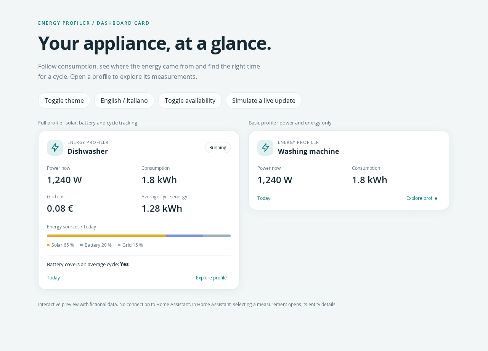

# Energy Profiler Card

A Home Assistant dashboard card for [Energy Profiler](https://github.com/nicola-spreafico/home-assistant-energy-profiler). A compact appliance summary opens a searchable dialog grouped into Overview, Energy, Running, Cycles and Standby.

**Browser Mod is not required.** The card owns its native modal dialog and uses Home Assistant's more-info event when you select a measurement. It never starts an appliance or changes a device.

## Preview



[Mobile detail dialog](docs/images/mobile-details.png) · Screenshots use fictional demo data.

## Features

- Period consumption, current power when available, grid cost and average cycle energy.
- Solar / battery / grid energy shares, or self / grid when separate sources are absent.
- Cycle battery coverage and readiness timestamps when exposed by the integration.
- Period selector, collapsible sections and measurement search.
- Optional technical attributes; missing sensor families are hidden.
- English and Italian, automatic Home Assistant language selection, light/dark themes and mobile layout.
- Visual configuration editor and support for renamed entities.

One card represents **one appliance/profile**. Global house rankings and self-sufficiency devices are not a dedicated view in this first implementation.

## Installation

The card targets the entity contract of Energy Profiler 3.0.0. Configure the integration and enable the sensors you want to display first.

### HACS

1. In HACS, add this repository as a **custom repository**, category **Dashboard**:
   `https://github.com/nicola-spreafico/home-assistant-energy-profiler-ui-card`.
2. Download Energy Profiler Card.
3. Reload the browser. If HACS has not registered a dashboard resource, add:
   `/hacsfiles/home-assistant-energy-profiler-ui-card/home-assistant-energy-profiler-ui-card.js`, type **JavaScript module**.
4. Add **Energy Profiler** from the dashboard card picker.

This is a custom repository, not a claim of inclusion in HACS's default catalog. Installation requires this repository and its bundle to have been pushed to GitHub.

### Manual

Copy `dist/home-assistant-energy-profiler-ui-card.js` (or the same file from a release) to `<config>/www/energy-profiler-card/`. Add this JavaScript module resource:

```text
/local/energy-profiler-card/home-assistant-energy-profiler-ui-card.js
```

After an update, reload the browser; change a resource URL query string if you need to invalidate its cache. Do not register both manual and HACS copies.

## Configuration

```yaml
type: custom:energy-profiler-card
prefix: lavastoviglie_em
name: Lavastoviglie
period: daily
# Optional: the appliance's actual instantaneous power sensor
power_entity: sensor.lavastoviglie_power
```

Use the integration's **complete entity prefix**, including `_em` or `_eim`. For example, `sensor.lavastoviglie_em_energy_daily` belongs to prefix `lavastoviglie_em`. Do not use a device display name.

| Option | Default | Meaning |
| --- | --- | --- |
| `prefix` | Required | Complete Energy Profiler profile prefix |
| `name` | Derived from prefix | Card title |
| `period` | `daily` | Initial accounting period |
| `power_entity` | Automatic | Optional current power sensor in W or kW |
| `language` | `auto` | `auto`, `en` or `it` |
| `show_sources` | `true` | Source-share summary |
| `show_readiness` | `true` | Battery coverage and readiness measurements |
| `show_technical` | `false` | Include technical helper entities and raw attributes |
| `entities` | `{}` | YAML-only mapping from measurement suffix to entity ID |

Supported periods: `hourly`, `daily`, `weekly`, `monthly`, `bimonthly`, `quarterly`, `yearly`, `lifetime`. Only available consumption periods appear; the first available period is used if the configured period is absent.

The card resolves entities using their stable unique IDs in the entity registry, with conventional entity names as a fallback. If registry access is restricted or a custom name cannot be resolved, supply overrides:

```yaml
type: custom:energy-profiler-card
prefix: lavastoviglie_em
entities:
  energy_daily: sensor.lavastoviglie_consumo_oggi
  battery_can_cover_average_cycle: binary_sensor.lavastoviglie_batteria_sufficiente
```

## Reading the card

### Compact view

Consumption, cost and source percentages refer to the **selected accounting period**, not instantaneous flow. When grid cost exists it is preferred; otherwise the card labels the integration's total consumption cost separately.

Current power comes from `power_entity`, or the sum of `power_from_self` and `power_from_grid`. Solar and battery are already part of self: they are **not added a second time**. Peak power is never substituted for current power. An unavailable explicit power sensor remains unavailable.

Three source channels are used only when both solar and battery percentage entities exist. Otherwise self and grid are used. An incomplete, unavailable or inconsistent percentage set does not draw a misleading stacked bar. Unknown/unavailable values are not converted into zero.

### Detail groups

- **Overview:** status, peak power and available source power measurements.
- **Energy:** consumption, costs, source attribution and self-energy indicators for the selected period.
- **Running:** running-only energy and related measurements.
- **Cycles:** completed/live cycles, cycle averages, period counts, battery coverage and readiness.
- **Standby:** standby state, duration and energy measurements.

Each group offers additional measurements from the profile. Search includes labels, suffixes and entity IDs across all periods. Selecting a measurement opens Home Assistant's standard entity detail. Escape, the close button or a backdrop click closes the card dialog.

### Battery and forecast

Battery coverage requires the integration's cycle and battery-energy configuration. Readiness timestamps are estimates produced by the integration, **not calculated by this card**, and do not guarantee a cycle can finish without importing energy.

Solcast is optional for the card itself. Solar forecast readiness appears only when the integration exposes that sensor after its Solcast configuration. Without battery or forecast entities, those features disappear and the rest of the card works.

### History and disabled entities

The period selector displays **current entity states**; it does not retrieve the previous month, reconstruct historical rankings or query long-term statistics. Historical details opened through Home Assistant depend on Recorder and the entity's supported history.

The card cannot enable disabled integration entities. Enable required entities in Home Assistant or omit those features. Technical helper entities are hidden by default.

## Development

Node.js 24 is recommended (minimum 22).

```sh
npm ci
npm test
npm run build
npx playwright install chromium
npm run test:browser
npm run dev
```

Open `http://127.0.0.1:4173` for the standalone demo. It contains **fictional data**, needs no Home Assistant connection, and includes full and minimal profiles, theme/language controls and unavailable-state simulation. For an existing Chromium installation, set `CHROMIUM_PATH` when running browser tests.

`npm run check` runs unit tests, builds the bundle and runs desktop/mobile browser tests. `dist/` is committed for HACS distribution; run `npm run build` after changing sources. No npm dependencies or remote scripts are required at runtime.

## Repository

- `src/`: card, editor, entity model, translations and styles.
- `dist/`: installable ES module and SHA-256 checksum.
- `demo/`: isolated mock Home Assistant frontend.
- `tests/`: model and Chromium interaction tests.
- `.github/workflows/`: CI and draft-release automation.

See [Contributing](CONTRIBUTING.md), [release checklist](docs/RELEASING.md) and [changelog](CHANGELOG.md). Automated demo tests do not replace a final test in a real Home Assistant dashboard.

## License

GPL-3.0-or-later. See [LICENSE](LICENSE).

## Platform references

[Home Assistant custom cards](https://developers.home-assistant.io/docs/frontend/custom-ui/custom-card/) · [Dashboard resources](https://developers.home-assistant.io/docs/frontend/custom-ui/registering-resources/) · [HACS dashboard plugin requirements](https://www.hacs.xyz/docs/publish/plugin/)
