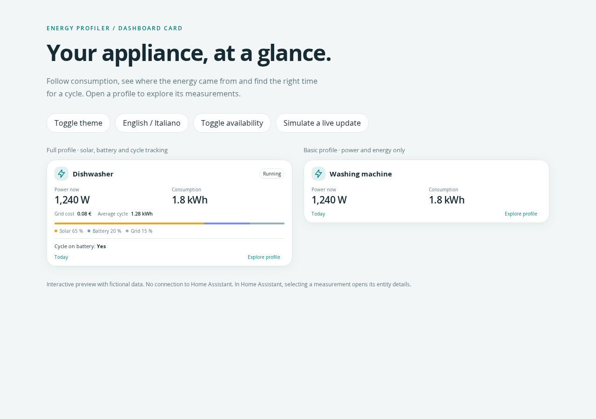

# Energy Profiler Card

A Home Assistant dashboard card for [Energy Profiler](https://github.com/nicola-spreafico/home-assistant-energy-profiler). A compact appliance summary opens a visual profile with topic navigation, energy charts, cycle comparisons and planning estimates.

**Browser Mod is not required.** The card owns its native modal dialog and uses Home Assistant's more-info event when you select a measurement. It never starts an appliance or changes a device.

## Preview



[Desktop detail](docs/images/details.png) · [Cycle comparison](docs/images/cycles.png) · [Mobile detail](docs/images/mobile-details.png) · Screenshots use fictional demo data.

## Features

- Period consumption, current power when available, grid cost and average cycle energy.
- Solar / battery / grid energy shares, or self / grid when separate sources are absent.
- Cycle battery coverage and readiness timestamps when exposed by the integration.
- Topic navigation: Overview, Energy, Cycles, Plan a cycle, Standby, Performance and Measurements.
- Daily consumption history from Lean long-term statistics, source donut, cost bars, running/standby breakdown and cycle progress against the average.
- Side-by-side live / last-completed / average cycle measurements, with readable durations.
- Period selector and a separate semantic measurement reference/search.
- Optional technical measurement reference; missing sensor families are hidden.
- English and Italian, automatic Home Assistant language selection, light/dark themes and mobile layout.
- Visual configuration editor and support for renamed entities.

One card represents **one appliance/profile**. Global house rankings and self-sufficiency devices are not a dedicated view in this first implementation.

## Installation

The card targets the entity contract of Energy Profiler 3.0.0. Configure the integration and enable the sensors you want to display first.

### HACS

1. In HACS, add this repository as a **custom repository**, category **Dashboard**:
   `https://github.com/nicola-spreafico/home-assistant-energy-profiler-ui-card`.
2. Download Energy Profiler Card.
3. Reload the browser. If HACS has not registered a dashboard resource, add:
   `/hacsfiles/home-assistant-energy-profiler-ui-card/home-assistant-energy-profiler-ui-card.js`, type **JavaScript module**.
4. Add **Energy Profiler** from the dashboard card picker.

This is a custom repository, not a claim of inclusion in HACS's default catalog. Installation requires this repository and its bundle to have been pushed to GitHub.

### Manual

Copy `dist/home-assistant-energy-profiler-ui-card.js` (or the same file from a release) to `<config>/www/energy-profiler-card/`. Add this JavaScript module resource:

```text
/local/energy-profiler-card/home-assistant-energy-profiler-ui-card.js
```

After an update, reload the browser; change a resource URL query string if you need to invalidate its cache. Do not register both manual and HACS copies.

## Configuration

```yaml
type: custom:energy-profiler-card
prefix: lavastoviglie_em
name: Lavastoviglie
period: daily
# Optional: the appliance's actual instantaneous power sensor
power_entity: sensor.lavastoviglie_power
```

Use the integration's **complete entity prefix**, including `_em` or `_eim`. For example, `sensor.lavastoviglie_em_energy_daily` belongs to prefix `lavastoviglie_em`. Do not use a device display name.

| Option | Default | Meaning |
| --- | --- | --- |
| `prefix` | Required | Complete Energy Profiler profile prefix |
| `name` | Derived from prefix | Card title |
| `period` | `daily` | Initial accounting period |
| `power_entity` | Automatic | Optional current power sensor in W or kW |
| `language` | `auto` | `auto`, `en` or `it` |
| `show_sources` | `true` | Source-share summary |
| `show_readiness` | `true` | Battery coverage and readiness measurements |
| `show_technical` | `false` | Include technical helpers and show entity IDs |
| `entities` | `{}` | YAML-only mapping from measurement suffix to entity ID |

Supported periods: `hourly`, `daily`, `weekly`, `monthly`, `bimonthly`, `quarterly`, `yearly`, `lifetime`. Only available consumption periods appear; the first available period is used if the configured period is absent.

The card resolves entities using their stable unique IDs in the entity registry, with conventional entity names as a fallback. If registry access is restricted or a custom name cannot be resolved, supply overrides:

```yaml
type: custom:energy-profiler-card
prefix: lavastoviglie_em
entities:
  energy_daily: sensor.lavastoviglie_consumo_oggi
  battery_can_cover_average_cycle: binary_sensor.lavastoviglie_batteria_sufficiente
```

## Reading the card

### Compact view

The compact summary prioritizes current power and period consumption. Cost and average-cycle energy sit on a smaller secondary line; source shares and battery coverage use compact rows. Full comparisons, charts and planning stay in the detail dialog.

Consumption, cost and source percentages refer to the **selected accounting period**, not instantaneous flow. When grid cost exists it is preferred; otherwise the card labels the integration's total consumption cost separately.

Current power comes from `power_entity`, or the sum of `power_from_self` and `power_from_grid`. Solar and battery are already part of self: they are **not added a second time**. Peak power is never substituted for current power. An unavailable explicit power sensor remains unavailable.

Three source channels are used only when both solar and battery percentage entities exist. Otherwise self and grid are used. An incomplete, unavailable or inconsistent percentage set does not draw a misleading stacked bar. Unknown/unavailable values are not converted into zero.

### Detail topics

The detail opens on a visual **Overview**, rather than an entity list. The accounting period selector affects period consumption, cost, sources and performance; **live power, current-cycle values and cycle averages keep their own meanings**.

| Topic | Content |
| --- | --- |
| Overview | Period consumption, current power and status, source donut, active cycle and daily history |
| Energy | Daily history, source percentages and kWh, grid purchases / avoided purchases, running / standby split, projections and accounting windows |
| Cycles | Active run, elapsed-time comparison with the mean, average energy/duration/value, valid count, live / completed / average comparison table, last-cycle boundaries and validation |
| Plan a cycle | Battery coverage, usable energy versus average demand, battery-ready time and Solcast window |
| Standby | Idle consumption and duration, its source mix and cost, and its place in total consumption |
| Performance | Self-energy index against the house baseline (1×) and extra self-produced kWh |
| Measurements | Reference grouped by meaning and context, filtered to the selected period and lifetime |

Optional topics disappear when their entities are absent. The reference does not open automatically. Search includes every available period, groups matches by meaning, and keeps technical helpers hidden unless `show_technical` is enabled. Selecting a measurement opens Home Assistant's entity detail. Escape, the close button or the backdrop closes the card dialog; arrow keys navigate topic buttons.

Unknown readings remain unknown. A running signal that is unavailable does not claim an appliance is idle. The elapsed-time meter is **a comparison with the observed mean**, not program progress; it stops at 100% and identifies overruns without predicting a negative remaining time.

### Charts and history

The history chart reads the last 15 days from the profile's **daily Lean consumption meter**, via Home Assistant's read-only Recorder statistics API. It uses each row's `state` (the day's consumption), not `sum` (the accumulated statistics baseline). Missing dates are not filled with zero. The latest day can be partial. Chart values are also available as a table.

Queries run only when the relevant detail is opened, are cached/shared for five minutes, and can be refreshed manually. Renamed daily entities use their resolved registry IDs. Empty history, disabled/missing daily meters and access/query failures have separate messages; none prevents the rest of the card from working.

The accounting-window tiles (today, this month, this year, lifetime) are labeled separately: overlapping windows are not plotted as a historical trend. Source charts do not double-count self along with its solar/battery parts. Mode charts retain an unclassified remainder and withhold a proportional split if the readings are inconsistent.

### Battery and forecast

Battery coverage requires the integration's cycle and battery-energy configuration. Readiness timestamps are estimates produced by the integration, **not calculated by this card**, and do not guarantee a cycle can finish without importing energy.

Solcast is optional for the card itself. Solar forecast readiness appears only when the integration exposes that sensor after its Solcast configuration. Without battery or forecast entities, those features disappear and the rest of the card works.

### Disabled entities and historical scope

The card cannot enable disabled integration entities. Enable required entities in Home Assistant or omit those features. Technical helper entities are hidden by default.

The period selector displays **current accounting windows**. The daily chart retrieves recorded long-term daily statistics; it does not select previous-month totals, reconstruct historical rankings or fetch a list of individual past cycles. The cycle comparison uses the integration's live, last-completed and average entities. Home Assistant's more-info history depends on Recorder and each entity's supported history.

## Development

Node.js 24 is recommended (minimum 22).

```sh
npm ci
npm test
npm run build
npx playwright install chromium
npm run test:browser
npm run dev
```

Open `http://127.0.0.1:4173` for the standalone demo. It contains **fictional data**, needs no Home Assistant connection, and includes full and minimal profiles, theme/language controls and unavailable-state simulation. For an existing Chromium installation, set `CHROMIUM_PATH` when running browser tests.

`npm run check` runs unit tests, builds the bundle and runs desktop/mobile browser tests. `dist/` is committed for HACS distribution; run `npm run build` after changing sources. No npm dependencies or remote scripts are required at runtime.

## Repository

- `src/`: card, editor, entity model, translations and styles.
- `dist/`: installable ES module and SHA-256 checksum.
- `demo/`: isolated mock Home Assistant frontend.
- `tests/`: model and Chromium interaction tests.
- `.github/workflows/`: CI and draft-release automation.

See [Contributing](CONTRIBUTING.md), [release checklist](docs/RELEASING.md) and [changelog](CHANGELOG.md). Automated demo tests do not replace a final test in a real Home Assistant dashboard.

## License

GPL-3.0-or-later. See [LICENSE](LICENSE).

## Platform references

[Home Assistant custom cards](https://developers.home-assistant.io/docs/frontend/custom-ui/custom-card/) · [Dashboard resources](https://developers.home-assistant.io/docs/frontend/custom-ui/registering-resources/) · [HACS dashboard plugin requirements](https://www.hacs.xyz/docs/publish/plugin/)
